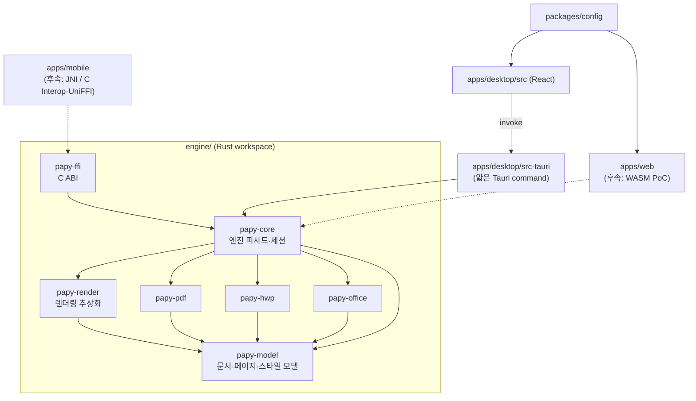

# 시스템 구조

기준: 2026-11-03 초기 구축 시점.

## 구성과 의존 방향

- 화살표는 "의존한다". 엔진 안쪽에서 앱 쪽으로 향하는 화살표는 없어야 한다.
- 점선은 아직 연결하지 않은 계획이다.

## 엔진 경계

| 규칙 | 내용 |
|---|---|
| UI 비의존 | `engine/**` 는 Tauri·React·Compose·SwiftUI 타입을 의존성으로 갖지 않는다 |
| 얇은 어댑터 | `src-tauri` 의 command 는 `papy-core` 호출과 타입 변환만 한다. 파싱·레이아웃은 엔진에만 |
| 모델/렌더 분리 | 편집 가능한 구조(`papy-model`)와 그린 결과(`papy-render`)를 같은 타입으로 다루지 않는다 |
| 포맷 어댑터 | 포맷별 crate 가 원본 특성을 보존하고, 공통 모델로 옮길 때 손실을 보고할 수 있게 한다 |
| 외부 엔진 | PDFium·MuPDF·HWP 파서 등은 라이선스 검토·승인 전까지 의존성에 넣지 않는다 |

## Cargo workspace 배치

- `engine/Cargo.toml` 이 엔진 workspace 다. `Cargo.lock` 도 `engine/` 에 있다.
- `apps/desktop/src-tauri` 는 빈 `[workspace]` 를 가진 독립 패키지이며 엔진을 `path` 의존성으로 가져온다.
  엔진 CI 가 Tauri·WebView 의존성 없이 돌도록 분리했다([decisions/0002](../decisions/0002-cargo-workspaces.md)).
- Rust 툴체인은 루트 `rust-toolchain.toml` 하나로 고정한다.

## 임시 파일·캐시

아직 만드는 곳이 없다. 렌더링 캐시를 도입할 때 위치·상한·삭제 시점을 여기에 기록한다.

## 관련 문서

- [플랫폼 연결 방식](platform-bridges.md)
- [KMP 템플릿 출처와 편입 기록](kmp-template-origin.md)
